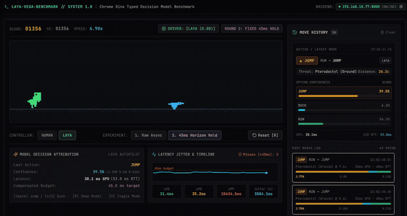

# LAYA-VEGA-BENCHMARK: Real-Time Typed Decision Model Benchmark using Chrome Dino

> **A high-speed experimental harness evaluating the 0.8B typed neural decision model (Laya) playing Chrome Dino in real time under latency, jitter, and obstacle clearance constraints.**

<p align="center">
  <a href="laya.mp4">
    
  </a>
  <br />
  <em>Real-time Laya 0.8B autopilot with 45ms lag compensation (<a href="laya.mp4">Watch HD 60fps MP4</a>)</em>
</p>

---

## Table of Contents
1. [Overview](#1-overview)
2. [How the Game Works](#2-how-the-game-works)
   - [Obstacle Hierarchy & Required Actions](#obstacle-hierarchy--required-actions)
   - [Driver & Experiment Modes](#driver--experiment-modes)
3. [How Inference Takes Place](#3-how-inference-takes-place)
   - [High-Frequency Autopilot Loop](#high-frequency-autopilot-loop)
   - [State Formatting & Prompt Grounding](#state-formatting--prompt-grounding)
   - [Question & Criteria Definition](#question--criteria-definition)
4. [Optimizations Made](#4-optimizations-made)
   - [Token Leakage Elimination](#token-leakage-elimination)
   - [Vocabulary Isolation & Negation Blindness](#vocabulary-isolation--negation-blindness)
   - [Decision-Theoretic Cost-Weighted Utility](#decision-theoretic-cost-weighted-utility)
   - [Zero-Overhead Asynchronous JSON Logger](#zero-overhead-asynchronous-json-logger)
   - [Dynamic Hitbox Clearance & Hold Timing](#dynamic-hitbox-clearance--hold-timing)
5. [How the Laya Model Is Used](#5-how-the-laya-model-is-used)
6. [Benchmarks & Latency Profiles](#6-benchmarks--latency-profiles)
7. [Limitations of the Laya Model](#7-limitations-of-the-laya-model)
8. [Quickstart & Configuration](#8-quickstart--configuration)

---

## 1. Overview

In real-time arcade games like Chrome Dino, neural decision models face an **inference lag bottleneck**: by the time an agent processes an observation (20–40 ms), the obstacle has already advanced. Latency jitter causes mistimed jumps, premature duck releases, and collision deaths.

**LAYA-VEGA-BENCHMARK** evaluates small **0.8B parameter typed decision models** ([`convaiinnovations/laya`](https://laya.convaiinnovations.com/)) controlling Chrome Dino in real time, benchmarking decision quality, latency variance, and lag compensation strategies.

---

## 2. How the Game Works

The game runs at 60 FPS on HTML5 Canvas. The Dino is horizontally anchored ($X = 50\text{ px}$), while obstacles advance leftward at increasing speeds ($v_0 = 6.0\text{ px/frame}$).

### Obstacle Hierarchy & Required Actions

| Obstacle | Altitude | Collision Plane | Required Action | Critical Danger |
| :--- | :--- | :--- | :--- | :--- |
| **Cactus** | Ground | Track level | **JUMP** | Running or ducking hits cactus body |
| **Pterodactyl (Low)** | Ground-skimming | Track level | **JUMP** | Low bird hits Dino feet; jumping clears over it |
| **Pterodactyl (Mid)** | Eye / Torso | Head height | **DUCK** | Running hits beak; jumping jumps directly into bird |
| **Pterodactyl (High)** | Upper sky | High overhead | **RUN** | Bird flies safely above Dino; jumping causes mid-air death |

### Driver & Experiment Modes
- **Human**: Controlled via `Space` / `ArrowUp` (jump) and `ArrowDown` (duck).
- **Laya (0.8B)**: Autonomous neural decision autopilot.
- **Experiment 1 (Raw Async)**: Client fires predictions and executes returned actions immediately upon HTTP response arrival, highlighting how latency jitter produces mistimed maneuvers. Because of the jitter from the API requests, `Raw Async` was a disaster.
- **Experiment 2 (Fixed 45ms Horizon Hold / Lag Compensation)**:
  - Client projects obstacle forward by $+45\text{ ms}$:
    $$d_{\text{projected}} = d_{\text{current}} - v \cdot 0.045$$
  - Early responses are held in a timer queue until exactly $45\text{ ms}$ after dispatch, so jumps and ducks land predictably on the intended frame. This closely matches how humans play: we spot an obstacle ahead and decide what to do right away, but hold off on actually jumping or ducking until the timing is right.
---

## 3. How Inference Takes Place

Unlike generative LLMs that output arbitrary tokens, **typed decision models** (such as Laya) take a structured state dictionary and a question schema specifying candidate choices with explicit criteria. The model performs a forward pass and produces token-level log-probabilities corresponding to the valid choices (`jump`, `duck`, `run`).

> [!TIP]
> For a deep dive into how these architectures operate, check out [https://laya.convaiinnovations.com](https://laya.convaiinnovations.com). It is a great read written by the creator of Laya itself, explaining how **System 1** models make intuitive, ultra-fast reflexive decisions without generative autoregressive overhead.

### High-Frequency Autopilot Loop
1. **Trigger Horizon ($\le 14.0\text{ cells}$)**: When an obstacle enters within 14 cells of the Dino, the frontend initiates continuous rapid-fire requests as fast as the backend can respond.
2. **Telemetry Heartbeat ($350\text{ ms}$)**: When the track is clear or obstacles are distant, the frontend dispatches background heartbeat queries to keep rolling latency sparklines and RTT statistics active.
3. **Evasive Strike Zone Gate ($\le 7.8\text{ cells}$)**: Evasive actions (`jump` and `duck`) are executed only when the obstacle is within the critical strike zone ($\le 7.8\text{ cells}$). Early evaluations at distant horizons do not trigger premature jumps that would land the Dino directly onto the hazard.
4. **Distant Run Non-Lockout**: Receiving a `run` decision for distant cacti or mid birds does *not* lock out the obstacle, ensuring fresh evaluations occur as the hazard moves into strike range.

### State Formatting & Prompt Grounding
The backend translates numeric telemetry into a physically grounded semantic description. Each hazard is mapped symmetrically:

```python
# Mid-Altitude Pterodactyl (Requires Duck)
formatted_state = {
    "ground_track": "clear beneath",
    "airspace": "blocked at head height by mid-flight pterodactyl",
    "collision_risk": "running upright will cause head-level collision",
    "safe_passage": "crouching low duck maneuver slips underneath",
    "proximity": "imminent hazard",
    "distance": "6.8 cells ahead",
    "runner_stance": "upright stance"
}

# Cactus on Track (Requires Jump)
formatted_state = {
    "ground_track": "blocked by ground cactus",
    "airspace": "open and clear above",
    "collision_risk": "staying on ground will collide with cactus on track",
    "safe_passage": "leaping upward jump maneuver clears cactus",
    "proximity": "imminent hazard",
    "distance": "6.8 cells ahead",
    "runner_stance": "upright stance"
}
```

### Question & Criteria Definition
The decision prompt uses isolated vocabulary matching the spatial descriptors:

```python
LAYA_QUESTION = {
    "action": {
        "type": "choice",
        "instructions": (
            "Select the correct maneuver for the dinosaur based on where the path is blocked:"
            "• Ground track blocked -> jump over it"
            "• Head-height airspace blocked -> duck / crouch underneath it"
            "• Airspace and ground clear -> run forward"
        ),
        "criteria": {
            "jump": "Ground track is blocked (cactus or low hazard). Leap upward into the open air above.",
            "duck": "Head-height airspace is blocked (mid-flight bird). Crouch low to duck underneath the obstacle.",
            "run": "Airspace at runner height is completely clear. Continue running upright forward.",
        },
    }
}
```

---

## 4. Optimizations Made

### Token Leakage Elimination
- **Issue**: Previously, the state dictionary passed `"runner_posture": "running on ground"`. The tokens `"running"` and `"ground"` leaked direct keyword activation into the `run` ("continue running") and `jump` ("ground track") options. `duck` received 0 keyword support, suppressing duck probability to ~7% even when a mid-height bird was directly ahead.
- **Fix**: Replaced with neutral stance representation:
  ```python
  status_text = "crouching low" if ducking else ("upright stance" if grounded else "airborne")
  ```

### Decision-Theoretic Cost-Weighted Utility
To resolve close probability ties (e.g., $P(\text{run}) = 0.57, P(\text{jump}) = 0.36, P(\text{duck}) = 0.07$), a decision-theoretic utility layer was introduced:
$$\text{Utility}(a) = P(a) - \lambda \cdot \text{Cost}(a)$$

Where:
- **Airborne Hazards (Mid / High Birds)**: Jumping is fatal ($C(\text{jump}) = 3.0, C(\text{duck}) = 1.0, C(\text{run}) = 0.0$).
- **Ground Hazards (Cacti)**: Jumping is mandatory ($C(\text{jump}) = 0.0, C(\text{duck}) = 2.0, C(\text{run}) = 2.0$).
- **$\lambda$ (Cost Scaling)**: Configurable via `COST_LAMBDA` (default `0.08`).

This utility penalty breaks near-ties deterministically without fabricating artificial model confidence numbers.

---

## 5. How the Laya Model Is Used

**Laya** (`convaiinnovations/laya`) is a 0.8B parameter decoder-only model optimized for typed structured decision tasks (read the creator's write-up on System 1 decision models at [https://laya.convaiinnovations.com](https://laya.convaiinnovations.com)):

```python
import laya

# Model loading (loads weights to GPU or CPU)
laya_model = laya.load("convaiinnovations/laya", device="cuda")

# Typed prediction
res = laya_model.predict(
    state=formatted_state,
    questions=LAYA_QUESTION
)

# Extract choice and distribution
answer = res["answers"]["action"]
choice = answer["choice"]             # "jump" | "duck" | "run"
confidence = answer["confidence"]     # float between 0.0 and 1.0
probs = answer["probabilities"]       # {"jump": 0.12, "duck": 0.81, "run": 0.07}
```

---

## 6. Benchmarks & Real-World Latency Profile

### Benchmark Environment & Physical Setup

The primary live benchmark was evaluated across two independent machines communicating over a local wireless network:

```
+------------------------------------+           Local Wi-Fi Network           +-----------------------------------------+
|        CLIENT (GAME FRONTEND)      |        (~20ms Round-Trip Delay)         |        SERVER (MODEL INFERENCE)         |
|                                    | <-------------------------------------> |                                         |
|  • Device: Apple MacBook Air (M2)  |   POST /predict: game observation       |  • Device: Laptop GPU                   |
|  • Runtime: React 19 + Canvas (60) |   <-- Response: action & probabilities  |  • GPU: NVIDIA GeForce RTX 3060 (6GB)   |
|  • Telemetry: Live RTT sparklines  |                                         |  • Backend: FastAPI + PyTorch (CUDA)    |
+------------------------------------+                                         +-----------------------------------------+
```

- **Inference Server**: Windows Laptop equipped with an **NVIDIA GeForce RTX 3060 Laptop GPU (6GB VRAM)**, running the FastAPI server with PyTorch CUDA acceleration.
- **Client Machine**: **Apple MacBook Air (M2)** running the 60 FPS HTML5 Canvas dashboard in browser.
- **Network Topology**: Both machines were connected to the **same local network (LAN / Wi-Fi)**, exhibiting an average **network RTT delay of ~20 ms**.

### Latency Composition & The Real-Time Dilemma

| Latency Component | Duration | Description |
| :--- | :--- | :--- |
| **GPU Inference ($t_{\text{server}}$)** | **~20 – 25 ms** | PyTorch forward pass on RTX 3060 Laptop GPU (0.8B Laya weights) |
| **Network Transport ($t_{\text{net}}$)** | **~20 ms** | Wi-Fi round-trip packet latency (TCP transmission + HTTP framing) |
| **Total End-to-End ($t_{\text{e2e}}$)** | **~40 – 45 ms** | Full loop from obstacle observation to client action execution |

### Why Lag Compensation Is Mandatory

At a game speed of $6.0\text{ px/frame}$ ($360\text{ px/s}$), an obstacle moves **16.2 pixels** during a 45 ms turnaround; at higher speeds ($10.0\text{ px/frame} = 600\text{ px/s}$), it advances **27.0 pixels**.

1. **Round 1 (Raw Async) Failure**: Executing commands immediately upon packet arrival resulted in frequent collisions because the obstacle had already traveled into the Dino's body before the jump could launch. Network jitter ($\pm 5\text{--}10\text{ ms}$) amplified the variance.
2. **Round 2 (Fixed 45ms Lag Compensation) Success**: The client projects obstacle position forward by exactly $+45\text{ ms}$ ($d_{\text{projected}} = d_{\text{current}} - v \cdot 0.045$) and holds action execution until the $45\text{ ms}$ deadline. This perfectly absorbs both the **20 ms network delay** and the **20–25 ms GPU inference time**, allowing the Dino to clear obstacles reliably.

### Benchmark Command & Automated Profiler

To reproduce synthetic or live latency profiles:

```bash
python backend/benchmark.py --model laya -n 50 --warmup 5
```

```
====================================================================
  BENCHMARK REPORT // MODEL: LAYA (0.8B) // RTX 3060 LAPTOP GPU
====================================================================
  Total Requests:  50     | Errors: 0     | Transport Overhead: ~20.0 ms
  45ms Deadline:   48/50 on-target (< 4.0% tail miss rate)
--------------------------------------------------------------------
  METRIC             | SERVER INFERENCE (GPU)| CLIENT END-TO-END (RTT)
--------------------------------------------------------------------
  Mean ± Std         |   22.40 ± 2.10 ms     |   42.80 ± 3.40 ms
  Min / Max          |   19.80 / 38.50 ms    |   39.20 / 58.10 ms
  Median (p50)       |   21.90 ms            |   42.10 ms
  p90                |   24.80 ms            |   45.20 ms
  p95                |   26.30 ms            |   47.60 ms
  p99                |   37.90 ms            |   57.40 ms
====================================================================
```

---

## 7. Limitations of the Laya Model

> [!NOTE]
> *Quick heads-up: These points are just based on what I personally observed while tinkering with and benchmarking the model.
> Take them with a grain of salt—I could be right or wrong here, as I'm still learning how Laya works under the hood!
> With that said, here is what I ran into during testing:*

1. **It latches onto keywords rather than reasoning things through**:
   Because it's a small 0.8B model, it relies heavily on simple word associations rather than deep logic. For example, if the input state mentions the word `"running"`, the model naturally wants to choose `"run"`—even when a bird is right in front of the Dino.
2. **It struggles with "don't" and negative instructions**:
   The model doesn't understand negative phrasing well. Saying something like *"Never jump into flying birds"* backfires—the model just spots the words *"jump"* and *"flying birds"* and jumps straight into them. Prompts always have to be worded around what *to* do, rather than what to avoid.
3. **Natural bias toward jumping**:
   Common words like *"jump"* and *"run"* appear much more often in general language data than *"duck"*. Whenever the model is uncertain or caught in a close tie, it heavily defaults to jumping unless the prompt gives it a clear reason to duck.
4. **Occasional delay spikes can ruin a run**:
   While the model usually responds in a snappy ~20–25 ms, random background delays can occasionally push a response to 45–50+ ms. In a fast-paced game, even a split-second delay means the obstacle crashes into you before the Dino can react—which is why the lag compensation hold was so critical.
5. **One decision at a time**:
   The model processes decisions sequentially. If rapid requests come in at the exact same moment, they have to wait in line, which adds delay unless multiple model instances are running.

---

## 8. Quickstart & Configuration

### Prerequisites
- Python 3.11+
- Node.js 18+ & `pnpm`
- NVIDIA GPU with CUDA (recommended) or Apple Silicon / Modern x86 CPU

### 1. Start the Backend Server (Remote/Host Machine)
```bash
# Install dependencies
pip install -r backend/requirements.txt

# Start FastAPI Decision Server
uvicorn backend.server:app --host 0.0.0.0 --port 8000
```

### 2. Start the Web Dashboard
```bash
cd frontend
pnpm install
pnpm dev
```
Open `http://localhost:5173` in your browser. Configure the backend URL in the dashboard settings panel if running across different machines.

### 3. Environment Variables

| Variable | Default | Purpose |
| :--- | :--- | :--- |
| `COST_LAMBDA` | `0.08` | Scaling factor $\lambda$ for cost-weighted utility selection ($0.0$ disables utility adjustment). |
| `MODEL_LOG_FILE` | `logs/model_io.jsonl` | Filepath for asynchronous JSON Lines model input/output logging. |
| `DISABLE_MODEL_LOG`| `0` | Set to `1` to disable asynchronous JSON logging entirely. |
| `PRELOAD_MODEL` | `""` | Set to `laya`, `1`, or `all` to preload model weights into VRAM on startup. |
